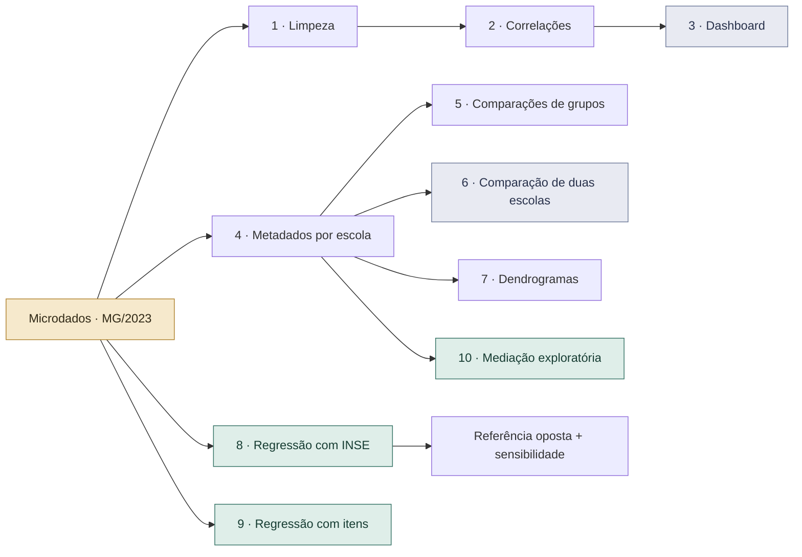

<div align="center">

# SAEB 2023 · Minas Gerais

### Contexto socioeconômico e proficiência escolar

Projeto de TCC em R para investigar associações entre o nível socioeconômico,\
as características das escolas e o desempenho em Matemática e Língua Portuguesa.


[Começar](#começar) · [Pipeline](#pipeline) · [Estrutura](#estrutura) · [Documentação](#documentação) · [Qualidade](#qualidade-e-próximos-passos)

</div>

---

## A pesquisa

**Como o perfil socioeconômico se relaciona com a proficiência das escolas de Minas Gerais?**

O projeto utiliza os microdados do SAEB 2023, transforma as respostas dos estudantes,
agrega informações por escola e realiza comparações de grupos, agrupamentos,
regressões e uma análise exploratória de mediação pelo INSE.

| Recorte local conferido em 20/10/2026 | Quantidade |
|:------------------------------------|-----------:|
| Registros de estudantes | **173.918** |
| Escolas distintas | **2.338** |
| Códigos distintos de município no arquivo | **851** |
| Escolas públicas / privadas nos metadados | **2.297 / 41** |

O CSV local contém exclusivamente `ID_SAEB = 2023` e `ID_UF = 31`. O arquivo
`TS_ALUNO_34EM.csv` abrange 3ª/4ª séries do Ensino Médio: foram encontrados
163.263 registros com `ID_SERIE = 12` e 10.655 com `ID_SERIE = 13`
(ensino tradicional e integrado, conforme o script de importação do INEP).
O enquadramento da amostra no texto do TCC deve explicitar essa abrangência.

**Unidade de análise dos modelos:** escola. `MEDIA_MT` e `MEDIA_LP` são médias
escolares; `INSE_MEDIO` é a média do `INSE_ALUNO` válido. As análises por escola
dos passos 2 e 3 trabalham com registros individuais.

> Os modelos descrevem associações em dados observacionais. A mediação é
> exploratória e usa contrastes explícitos entre os grupos declarados.
> As correções e verificações estão na [análise do projeto](TESTE/DOCUMENTACAO/analise_projeto.md).

## Começar

### 1. Preparar o ambiente e os dados

Use **R 4.6.0** e as versões registradas em [renv.lock](renv.lock).
No console do R, a partir da raiz:

```r
install.packages("renv")
renv::restore(prompt = FALSE)
```

O executor confere o ambiente antes de iniciar as análises. Consulte
[requisitos.md](TESTE/DOCUMENTACAO/requisitos.md) para detalhes.

Obtenha os [microdados no INEP](https://www.gov.br/inep/pt-br/acesso-a-informacao/dados-abertos/microdados/saeb)
e disponibilize o arquivo neste caminho relativo à raiz:

```text
MICRODADOS_SAEB_2023/DADOS/TS_ALUNO_34EM.csv
```

**O arquivo deve conter o recorte desejado de MG/2023.** A leitura valida UF, ano e séries e interrompe o processamento se houver
registros fora do recorte. Prepare o arquivo nacional antes de usá-lo.

Em 29/10/2026, a entrada local foi atualizada com o recorte de MG extraído de
`TS_ALUNO_34EM_brasiltodo.csv`: 173.918 alunos, 2.338 escolas e 117 colunas.
A atualização recuperou 250 notas e trouxe os demais campos da fonte nacional.
O CSV anterior foi preservado em backup local; a proveniência e os hashes estão
em `TESTE/DOCUMENTACAO/outputs/2026-10-29/metadados/atualizacao_fonte_MG_102852.json`.
Resultados e manifestos anteriores à troca correspondem à entrada antiga;
é necessário reexecutar o pipeline para atualizar tabelas, modelos e figuras.

### 2. Conferir a instalação

Abra o terminal **na raiz deste repositório**:

```powershell
Rscript TESTE/DOCUMENTACAO/verificar_dependencias.r
Rscript TESTE/DOCUMENTACAO/validar_pipeline.r
```

Se `Rscript` não estiver no `PATH`, use o executável da instalação do R ou
configure o `PATH`. A detecção da raiz procura `TESTE/` a partir da pasta
de trabalho e de seus diretórios ancestrais.

O validador verifica sintaxe e alguns invariantes dos metadados existentes.
Sem metadados, ele informa que a parte de dados foi ignorada.

### 3. Escolher a execução

```powershell
# Etapas nao interativas: 1, 2, 4, 5, 7, 8, 9 e 10
Rscript executar_pipeline.r

# Ramo de analise agregada: gera metadados e executa comparacoes e modelos
Rscript executar_pipeline.r --passos=4,5,7,8,9,10 --auxiliares

# Apenas regressao principal e seus dois auxiliares
Rscript executar_pipeline.r --passos=8 --auxiliares
```

O executor inicia cada script em uma sessão R isolada e interrompe a sequência
se um script terminar com erro. Selecionar passos acrescenta seus produtores: o passo 2 inclui o 1;
os passos 5, 7 e 10 incluem o 4. Os consumidores leem somente artefatos
produzidos na execução corrente.

`--auxiliares` acrescenta o gráfico com referências opostas e a análise
OLS/WLS com HC3 quando o passo 8 está selecionado. O passo 9 é complementar
à pesquisa, mas está incluído na execução automática padrão.

## Pipeline

Os dez passos organizam o trabalho; as dependências de arquivos formam
ramos. Os passos 4, 8 e 9 leem o CSV bruto diretamente.



| Passo | Módulo | Script | Entrada efetiva |
|:-----:|:------:|--------|-----------------|
| 1 | 1 | [ajeitar_dados.r](TESTE/1_LIMPEZA_E_TRANSFORMACAO/ajeitar_dados.r) | CSV bruto |
| 2 | 2 | [correlacao.r](TESTE/2_ANALISE_POR_ESCOLA/Scripts/correlacao.r) | Arquivos por escola do passo 1 |
| 3 | 2 | [graficos.r](TESTE/2_ANALISE_POR_ESCOLA/Scripts/graficos.r) | Saídas do passo 2; interativo |
| 4 | 3 | [classificar_escolas.r](TESTE/3_ANALISE_DE_GRUPOS/Scripts/classificar_escolas.r) | CSV bruto |
| 5 | 3 | [comparar_grupos.r](TESTE/3_ANALISE_DE_GRUPOS/Scripts/comparar_grupos.r) | Metadados do passo 4 |
| 6 | 3 | [comparar_duas_escolas.r](TESTE/3_ANALISE_DE_GRUPOS/Scripts/comparar_duas_escolas.r) | Metadados e dados das escolas; configuração manual |
| 7 | 3 | [dendrograma_analise_completa.r](TESTE/3_ANALISE_DE_GRUPOS/Scripts/dendrograma_analise_completa.r) e quatro perspectivas | Metadados do passo 4 |
| 8 | 4 | [regressao_linear_multipla.r](TESTE/4_REGRESSAO_LINEAR/Scripts/regressao_linear_multipla.r) | CSV bruto; agregação própria |
| 9 | 5 | [regressao_itens_brutos_dummy.r](TESTE/5_REGRESSAO_ITENS_BRUTOS/Scripts/regressao_itens_brutos_dummy.r) | CSV bruto; proporções de respostas por escola |
| 10 | 6 | [analise_mediacao.r](TESTE/6_ANALISE_MEDIACAO/Scripts/analise_mediacao.r) | Metadados do passo 4 |

O executor também executa, no passo 7, os dendrogramas por tipo de escola,
localização, área e `AREA_LOCAL`. A versão
[dendrogramas_artigo.r](TESTE/3_ANALISE_DE_GRUPOS/Scripts/dendrogramas_artigo.r)
é um auxiliar manual e seleciona escolas extremas para apresentação.

<details>
<summary><strong>Abrir as etapas manuais</strong></summary>

No console do R, a partir da raiz:

```r
shiny::runApp("TESTE/2_ANALISE_POR_ESCOLA/Scripts/graficos.r")
```

Para comparar duas escolas, configure os identificadores e o modo de entrada em
`comparar_duas_escolas.r` antes da execução:

```powershell
Rscript TESTE/3_ANALISE_DE_GRUPOS/Scripts/comparar_duas_escolas.r
Rscript TESTE/3_ANALISE_DE_GRUPOS/Scripts/dendrogramas_artigo.r
```

</details>

## Estrutura

```text
tcc/
├── README.md                         Apresentação e início rápido
├── executar_pipeline.r               Executor das etapas não interativas
├── diario.md                         Histórico por mês, do recente ao antigo
├── AGENTS.md                         Convenções de trabalho
├── refs/                             Referências bibliográficas em PDF
├── MICRODADOS_SAEB_2023/
│   ├── DADOS/                        CSVs locais, fora do Git
│   └── INPUTS/                       Scripts de importação do INEP
└── TESTE/
    ├── DOCUMENTACAO/                 Helpers, validação e guias
    ├── 1_LIMPEZA_E_TRANSFORMACAO/     Transformação no nível do aluno
    ├── 2_ANALISE_POR_ESCOLA/          Correlações e dashboard
    ├── 3_ANALISE_DE_GRUPOS/           Metadados, comparações e dendrogramas
    ├── 4_REGRESSAO_LINEAR/           Modelo principal e sensibilidade
    ├── 5_REGRESSAO_ITENS_BRUTOS/      Exploração complementar dos itens
    │   └── arquivo/                  Versão obsoleta, fora do executor
    └── 6_ANALISE_MEDIACAO/            Mediação exploratória pelo INSE
```

### Saídas e rastreabilidade

O padrão obrigatório para novas saídas é:

```text
<modulo>/outputs/<YYYY-MM-DD>/<tipo>/<nome>_<HHMMSS>.<ext>
```

Use `caminho_saida()` de [utils_saeb.r](TESTE/DOCUMENTACAO/utils_saeb.r).
O helper cria pastas e acrescenta um contador se o nome já existir.
`encontrar_arquivo_mais_recente()` localiza CSVs nos formatos datado e legado;
a consulta manual prioriza o layout datado e ordena por data, horário e contador.

**Todos os seis módulos gravam novas saídas datadas.** Nos módulos 1 e 2,
as tabelas ficam em pastas por escola dentro de `tabelas/<ID_ESCOLA>/`.
Os leitores preservam a consulta a arquivos legados, sem alterar o histórico.
O executor gera manifestos com hashes MD5, parâmetros, versões, logs e catálogo
de entradas e saídas em `TESTE/DOCUMENTACAO/outputs/<data>/`.

Dados brutos e `outputs/` são locais e ignorados pelo Git.

### Modelo principal

Para cada disciplina, a regressão relaciona a média escolar ao `INSE_MEDIO`
padronizado, a `TIPO_ESCOLA` e a `AREA_LOCAL`.

| Variável | Referência principal | Alternativas observadas |
|----------|----------------------|-------------------------|
| `TIPO_ESCOLA` | `Publica` | `Privada` |
| `AREA_LOCAL` | `Urbana_Capital` | `Urbana_Interior`, `Rural_Interior` |

`Rural_Capital` não foi observada nos metadados locais. `AREA` e `LOCALIZACAO`
permanecem para descrição. Os critérios de inclusão diferem entre os módulos:
as 2.338 escolas do arquivo não representam o tamanho de todos os modelos.
A base agregada mais recente do passo 8 contém **2.326 escolas**.

## Documentação

| Para consultar | Documento |
|----------------|-----------|
| Avaliação da estrutura, problemas e plano de melhorias | [Análise do projeto](TESTE/DOCUMENTACAO/analise_projeto.md) |
| Guia operacional complementar | [Documentação do pipeline](TESTE/DOCUMENTACAO/README.md) |
| Decisões e justificativas estatísticas | [Metodologia](TESTE/DOCUMENTACAO/metodologia.md) |
| Nomes e conteúdo das saídas | [Referência de outputs](TESTE/DOCUMENTACAO/referencia_outputs.md) |
| Instalação e dependências | [Requisitos](TESTE/DOCUMENTACAO/requisitos.md) |
| Mudanças e decisões ao longo do tempo | [Diário de desenvolvimento](diario.md) |
| Regras para colaboradores | [AGENTS.md](AGENTS.md) |

As decisões metodológicas estão centralizadas em `metodologia.md`. O guia
operacional explica a restauração do ambiente, os manifestos e a validação.

## Qualidade e próximos passos

- Classificações preservam ausentes; testes impedem faixas válidas sem a medida.
- Correlações incluem dummies, ordinais e INSE, com pares válidos por disciplina.
- Mediação de localização usa somente os dois grupos declarados.
- Regras de validade e agregação são compartilhadas, com denominadores explícitos.
- Saídas datadas, ambiente fixado e leitura vinculada à execução preservam rastreabilidade.

A interpretação final ainda requer justificar a faixa operacional de notas,
a estratégia de ponderação e os pressupostos da mediação. As análises
exploratórias não estabelecem identificação causal.

Confira os resultados de verificação e as decisões na
[análise do projeto](TESTE/DOCUMENTACAO/analise_projeto.md) e no [diário](diario.md).

**Validação em 20/10/2026:** 29 scripts, casos sintéticos e metadados de
2.338 escolas aprovados. Correlações regeneradas para 2.328 escolas, com
10 exclusões documentadas; modelos, auxiliares e leitores também verificados.
